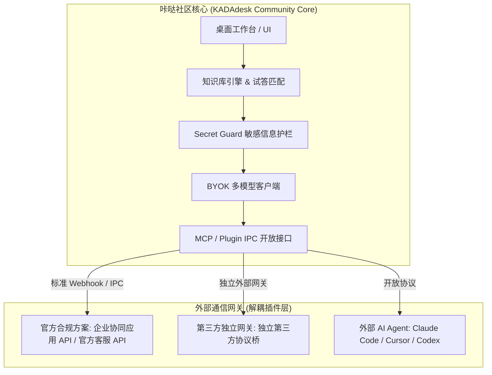

# KADAdesk 社区插件架构与外部渠道接入规范 (Plugin Architecture V1)

> **标杆参考：** 本规范参考了 **Dify、FastGPT 与 n8n** 的生态设计思想——**核心引擎保持干净合规，第三方外部通信渠道通过解耦的标准化接口接入**。

---

## 一、为什么核心仓库不捆绑非官方外挂？

在行业成熟产品（如 Dify、FastGPT）中，官方核心仓库**绝不会内置个人账号的网页协议逆向破解、内存注入或模拟操作脚本**：
1. **法律与合规安全**：避免第三方平台针对开源核心仓库发起法务维权或 DMCA 下架。
2. **防封号风控隔离**：非官方外挂特征容易被平台集中风控导致批量封号；将核心引擎与渠道网关解耦，能将风控风险完全隔离在外部。
3. **商业与社区权责清晰**：社区版聚焦本地知识大脑、安全护栏与桌面交互，通信渠道接入完全遵循标准协议。

---

## 二、Dify 风格的渠道接入方案（三层架构）

---

## 三、外部渠道的接入形态

### 1. 官方合规渠道（企业级推荐，零封号风险）
- **企业应用协同 / 官方客服 API**：
  - 走平台官方公开的 HTTP 回调与发送接口。
  - 咔哒仅需作为 Webhook 服务端接收消息，调用本地知识库试答后回调响应，100% 合规，永不封号。

### 2. 独立外部网关桥接（店主私有部署）
- 借鉴 Dify 生态中独立 Gateway 网关的模式：
  - 咔哒核心通过开放的 MCP（Model Context Protocol）或轻量 HTTP API 暴露 `query_knowledge`、`draft_reply` 接口。
  - 具体的自动化网关作为一个**独立的轻量辅助进程**运行在宿主机上，通过标准接口调用咔哒。
  - **核心仓库保持零污染，用户按需在本地私密挂载。**
